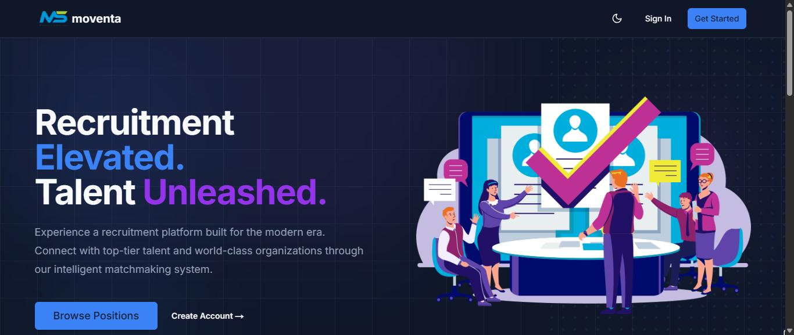
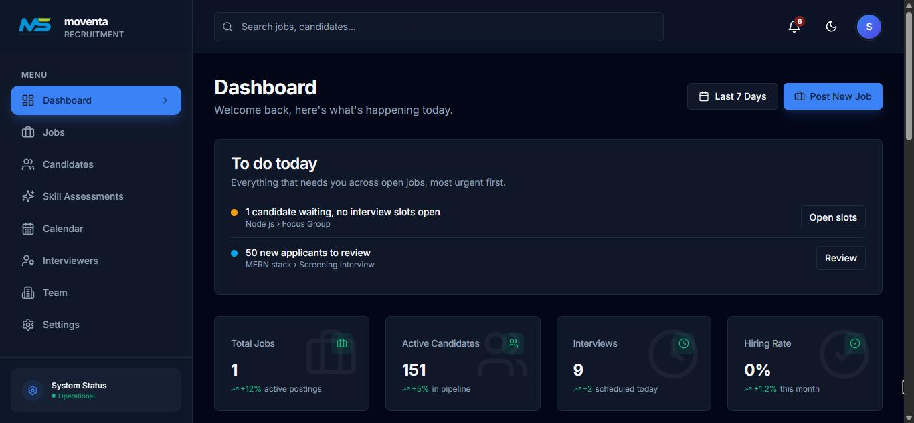
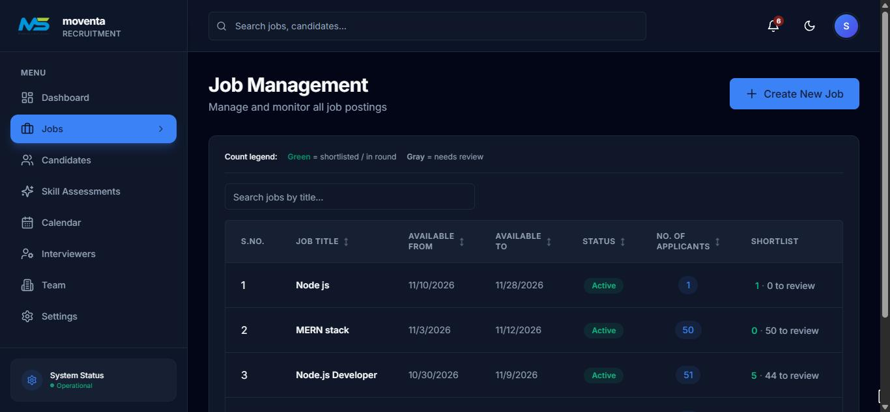
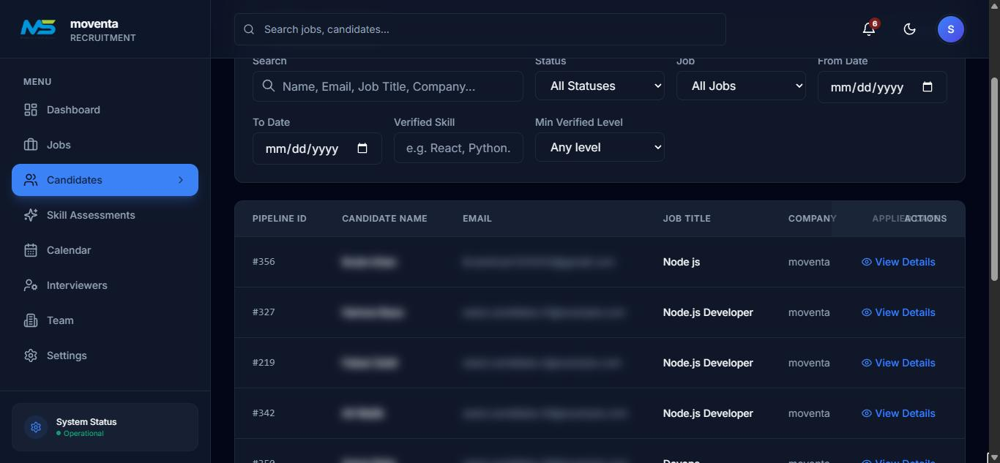
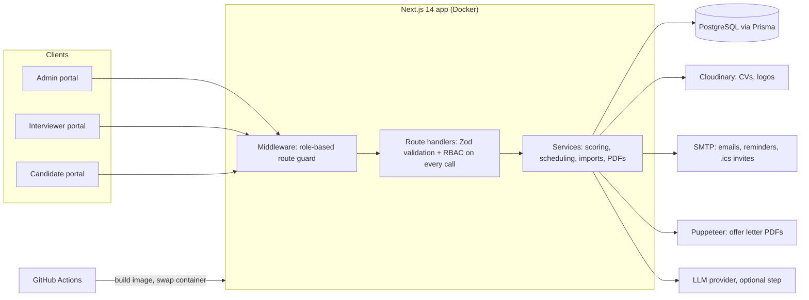

# Moventa: Applicant Tracking System

**Case study.** The source code belongs to Meteoric Solutions and is private. This repository explains what the product does, how it is built and what I worked on.

**Live:** [moventa.meteoricsolutions.com](https://moventa.meteoricsolutions.com)
**My role:** Full-stack developer. I designed and built the platform end to end: data model, API, all three portals, deployment and tests.
**Timeline:** November 2025 to present

## The problem

Teams hiring at volume get hundreds of applicants for a single job. Screening by hand is slow and inconsistent, scheduling interviews turns into long email threads, and candidates never know where they stand.

## What I built

One platform that covers the whole hiring journey, with three role-based portals on a single database:

- **Admin:** post jobs, design a hiring workflow per job (screening, focus group, final interview, custom rounds, offer), shortlist applicants and send offer letters.
- **Interviewer:** set weekly availability, see only the interviews assigned to them, and fill in scorecards.
- **Candidate:** build a profile, take skill tests, apply, book an interview slot and accept an offer in the portal.

| Admin dashboard | Job management |
|---|---|
|  |  |

## Architecture

## Engineering decisions

- **Shortlisting that stays cheap and explainable.** Hard filters run first, then every applicant gets a free, deterministic score (skills, education, experience, assessments). Only the top candidates go to a language model for a second opinion. Each result shows its score breakdown, so a recruiter can see why someone was shortlisted.
- **No double booking.** Slot capacity is updated with an atomic conditional `UPDATE`, and a unique key allows only one active booking per candidate per round. The slot generator (availability minus time off minus busy time) is a pure, unit-tested function.
- **Safe bulk import from Excel.** Upload, validate (nothing written), review, then apply in small chunks. A file hash makes sure the same file is never applied twice.
- **Two layers of authorization.** Middleware guards pages by role, and every API handler checks permissions again on the server.
- **Secrets handled properly.** API keys that admins enter in the UI are encrypted at rest (AES-256-GCM), and outbound endpoints are validated against SSRF.
- **Timezone-correct scheduling.** All slot maths runs in the organization's timezone, not the browser's.
- **Hardened deployment.** Multi-stage Docker build, read-only root filesystem, dropped Linux capabilities and resource limits. GitHub Actions builds the new image before swapping the container.

## Scale

About 51 database models, 125 API routes and 53 pages. Tested with 37 unit test files and 43 scripted end-to-end browser journeys.

## Stack

Next.js 14 (App Router), React, TypeScript, Tailwind CSS, shadcn/ui, Zustand, TanStack Table · PostgreSQL, Prisma, NextAuth v5, Zod · Puppeteer, ExcelJS, Cloudinary, Nodemailer · Docker, Docker Compose, GitHub Actions, PM2

---

Aliyan Siddiqui · [Portfolio](https://portfolio-aliyan-siddiqui.netlify.app) · [LinkedIn](https://www.linkedin.com/in/aliyan-siddiqui555/)
